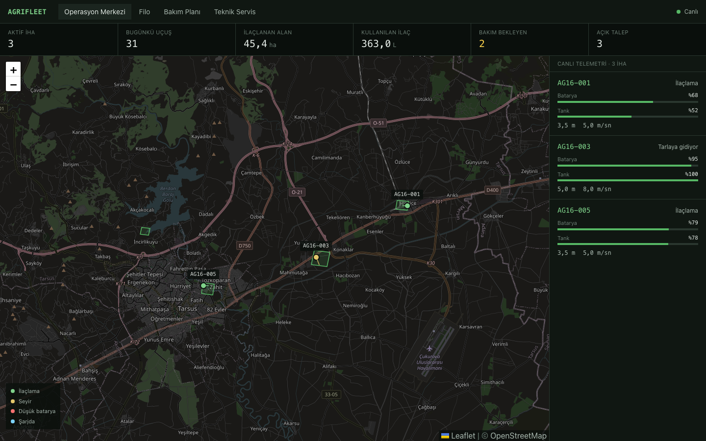
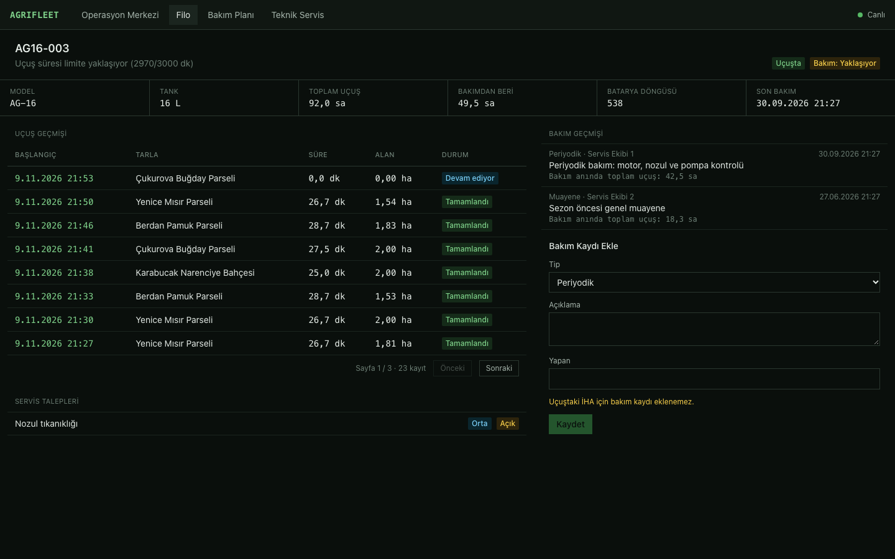
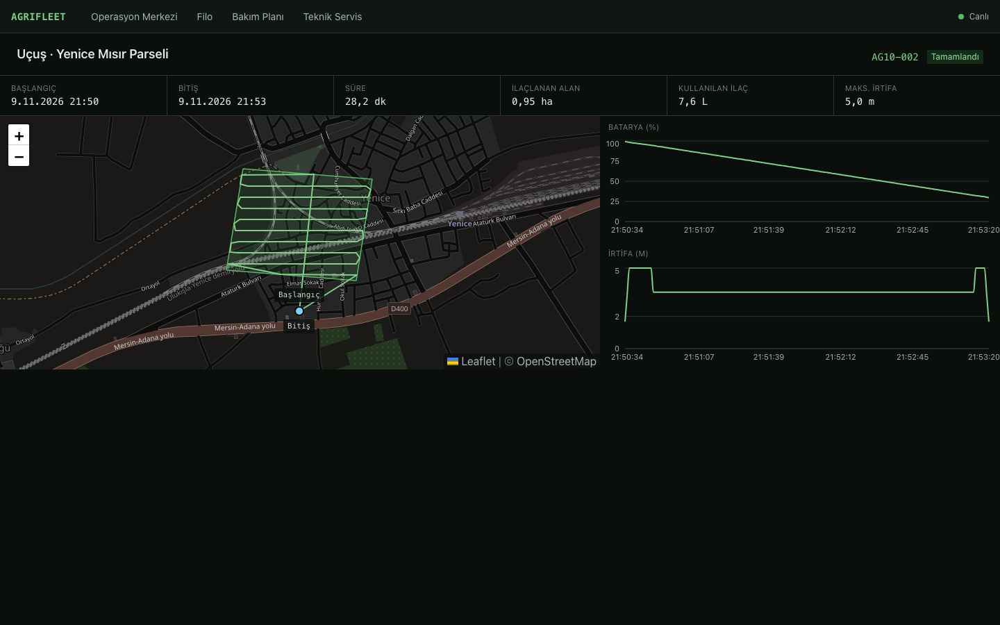
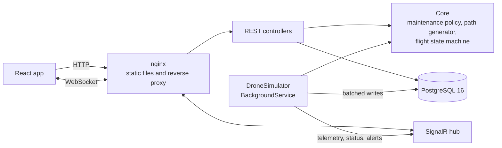
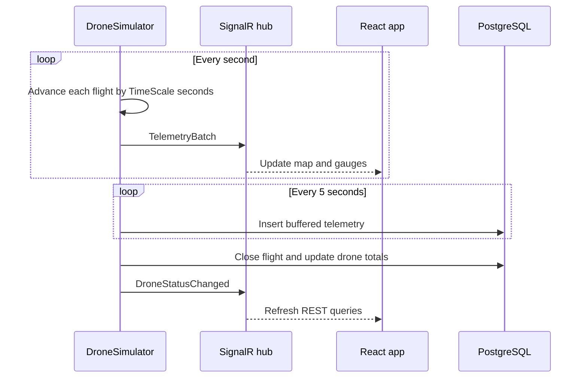

# AgriFleet

> **TR:** AgriFleet, tarımsal ilaçlama İHA'ları için bir filo yönetim platformudur. Filo takibi, canlı telemetri, uçuş kayıtları, bakım planlama ve teknik servis taleplerini tek ekranda toplar. Gerçek zamanlı veri, sunucudaki bir simülatörden SignalR ile tarayıcıya akar. Tek komutla çalışır: `docker compose up --build`, ardından http://localhost:8080.

Fleet management for agricultural spraying drones: live map, real-time telemetry, flight logs, maintenance planning and service tickets.

<!--  -->



## Features

- **Operations center:** KPI strip, live map with field polygons, drone markers and trails, per-drone battery and tank gauges, alert toasts.
- **Real-time telemetry:** a server-side simulator flies boustrophedon spray paths and streams one update per second over SignalR.
- **Fleet:** status and computed maintenance state for every drone, with flight, maintenance and ticket history per drone.
- **Flight logs:** paged history, route replay on a map, battery and altitude charts.
- **Maintenance planning:** due and overdue drones sorted by urgency, with rules based on flight time and calendar time.
- **Service tickets:** create, filter and move through their lifecycle.
- **Technician app:** a Flutter app for the field, with the fleet list, maintenance records and service tickets.

| Drone detail | Flight replay |
| --- | --- |
|  |  |

## Run it

Requires Docker.

```bash
docker compose up --build
```

| What | Where |
| --- | --- |
| Web app | http://localhost:8080 |
| Swagger | http://localhost:5080/swagger |
| Health check | http://localhost:5080/health |

Migrations and seed data are applied on startup, and the simulator starts flying within a few seconds. To reset everything:

```bash
docker compose down -v
```

### Local development

Requires the .NET 8 SDK, Node 20+ and Docker.

```bash
docker compose up -d postgres
dotnet run --project src/AgriFleet.Api --urls http://localhost:5080
npm run dev --prefix web
```

The Vite dev server runs on http://localhost:5173 and proxies `/api` and `/hubs` to the API.

### Technician app

Requires Flutter. With the backend running:

```bash
cd mobile
flutter run
```

On an Android emulator, pass `--dart-define=API_BASE_URL=http://10.0.2.2:8080` so the app can reach the host machine.

### Tests

```bash
dotnet test
cd mobile && flutter test
```

## Architecture



| Project | Responsibility |
| --- | --- |
| `src/AgriFleet.Core` | Entities, DTOs, validators and pure domain logic. No database or web dependencies. |
| `src/AgriFleet.Infrastructure` | `DbContext`, EF Core configurations, migrations and seed data. |
| `src/AgriFleet.Api` | Controllers, SignalR hub, simulator and application startup. |
| `tests/AgriFleet.Tests` | xUnit tests for the domain logic and validators. |
| `web` | React dashboard. |
| `mobile` | Flutter technician app using the same REST API. |

## Tech stack

- **Backend:** .NET 8, ASP.NET Core Web API, EF Core 8 with Npgsql, SignalR, FluentValidation, Swagger, ProblemDetails
- **Database:** PostgreSQL 16
- **Frontend:** Vite, React 18, TypeScript (strict), react-leaflet, @microsoft/signalr, TanStack Query, React Router, Recharts, Tailwind CSS
- **Mobile:** Flutter, Material 3, http
- **Tests:** xUnit, FluentAssertions, flutter_test
- **Infrastructure:** Docker Compose, nginx, GitHub Actions

## API overview

| Method | Route | Description |
| --- | --- | --- |
| GET | `/api/dashboard/summary` | Active drones, today's flights, hectares and liquid, maintenance and ticket counts |
| GET | `/api/drones` | Drones with computed maintenance status |
| GET | `/api/drones/{id}` | Single drone |
| POST | `/api/drones` | Register a drone |
| PATCH | `/api/drones/{id}/status` | Change a drone's status |
| GET | `/api/fields` | Fields with polygon boundaries |
| GET | `/api/flights?droneId=&from=&to=&page=&pageSize=` | Paged flight history |
| GET | `/api/flights/{id}` | Single flight |
| GET | `/api/flights/{id}/telemetry` | Recorded telemetry for a flight |
| GET | `/api/drones/{id}/maintenance` | Maintenance history |
| POST | `/api/drones/{id}/maintenance` | Record maintenance and reset counters |
| GET | `/api/maintenance/due` | Due and overdue drones, most urgent first |
| GET | `/api/service-tickets?status=&droneId=` | List tickets |
| POST | `/api/service-tickets` | Create a ticket |
| PATCH | `/api/service-tickets/{id}/status` | Change a ticket's status |
| GET | `/health` | Application and database health |

Errors use the ProblemDetails format.

## Real-time flow

The hub lives at `/hubs/telemetry` and pushes three events:

| Event | Payload | Sent |
| --- | --- | --- |
| `TelemetryBatch` | Latest point for each airborne drone | Every second |
| `DroneStatusChanged` | Drone id and status | On every status change |
| `AlertRaised` | Severity and message | Low battery, empty tank, aborted flight, maintenance becoming overdue |



Live and persisted data take separate paths. Clients receive every point immediately, while the database receives small batches. On startup the simulator closes flights left in progress by a previous run, so the system returns to a consistent state after a restart.

## Maintenance rules

A drone is due for service after **3000 flight minutes** or **90 days** since its last maintenance, whichever comes first. It is reported as `DueSoon` from 90% of either limit and `Overdue` once a limit is reached.

## Design decisions

- **Docker Compose runs the API in the Development environment.** Seed data and the simulator are tied to that environment so that one command gives a working demo. A production deployment would disable both.
- **Controllers use `DbContext` directly.** The endpoints are simple, so a repository or service layer would add indirection without value. Domain rules live in `Core` as pure code.
- **Validators live in `Core`.** The test project can then exercise them while referencing only `Core`. FluentValidation is the one package `Core` depends on.
- **The maintenance policy runs in application code, not SQL.** The rule stays in one testable place, at the cost of loading all drones. This is fine for fleet-sized data.
- **Field boundaries are stored as `jsonb` rather than PostGIS geometry.** The app only draws polygons and generates paths from them. Spatial queries would justify PostGIS.
- **Simulated time and wall-clock time are separate.** `DurationMinutes` and maintenance counters use simulated time, while timestamps are real. A 28-minute flight therefore shows about three minutes between its start and end.
- **Spray swath width is scaled for the demo.** It is chosen so each flight covers about 7 km and the pattern is visible on the map. Real swaths are a few meters wide.
- **Spray paths assume convex fields.** Each row runs between the outermost polygon intersections.
- **A drone's maintenance clock starts at registration**, so `LastMaintenanceAt` is never empty.
- **"Today" on the dashboard means the current UTC day.** Timestamps are stored in UTC and converted to local time only for display.
- **Overdue drones keep flying.** Overdue maintenance raises an alert but does not ground the drone.
- **Telemetry is written every 5 seconds.** A crash can lose up to the last 5 seconds of recorded telemetry in exchange for far fewer database transactions.
- **The simulator assumes a single API instance.** Active flights are held in memory.
- **Only the five most recent seeded flights include telemetry**, which keeps the database small.

## Roadmap

- Authentication and role-based access
- MQTT ingestion for real drone telemetry
- Geofencing
